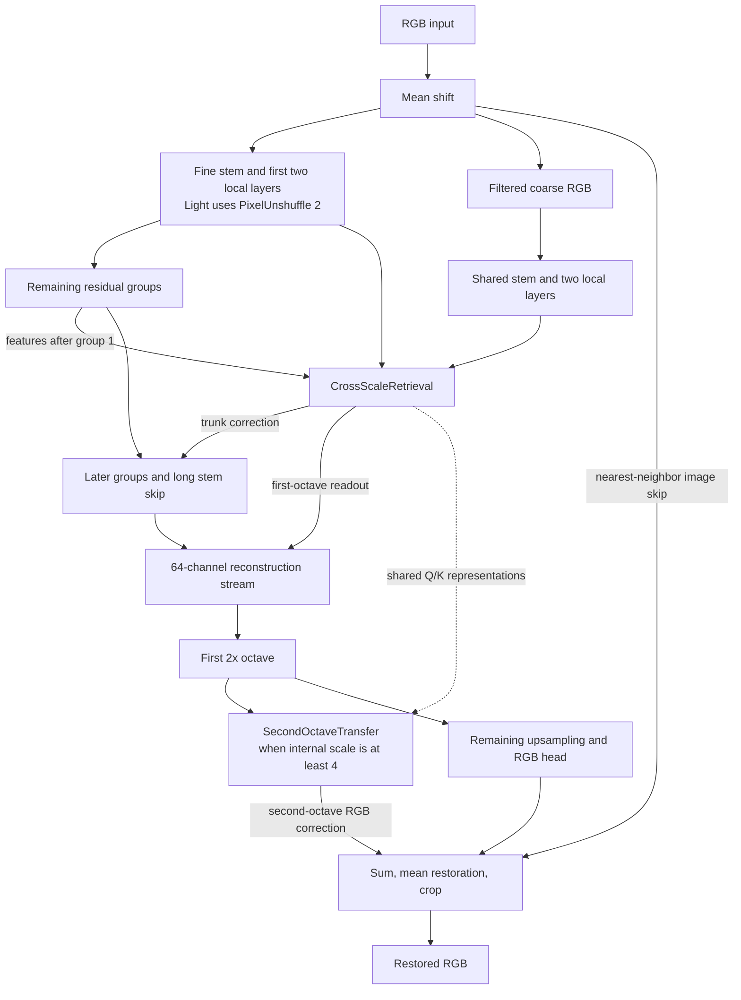
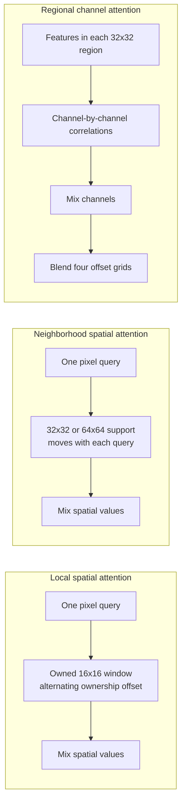
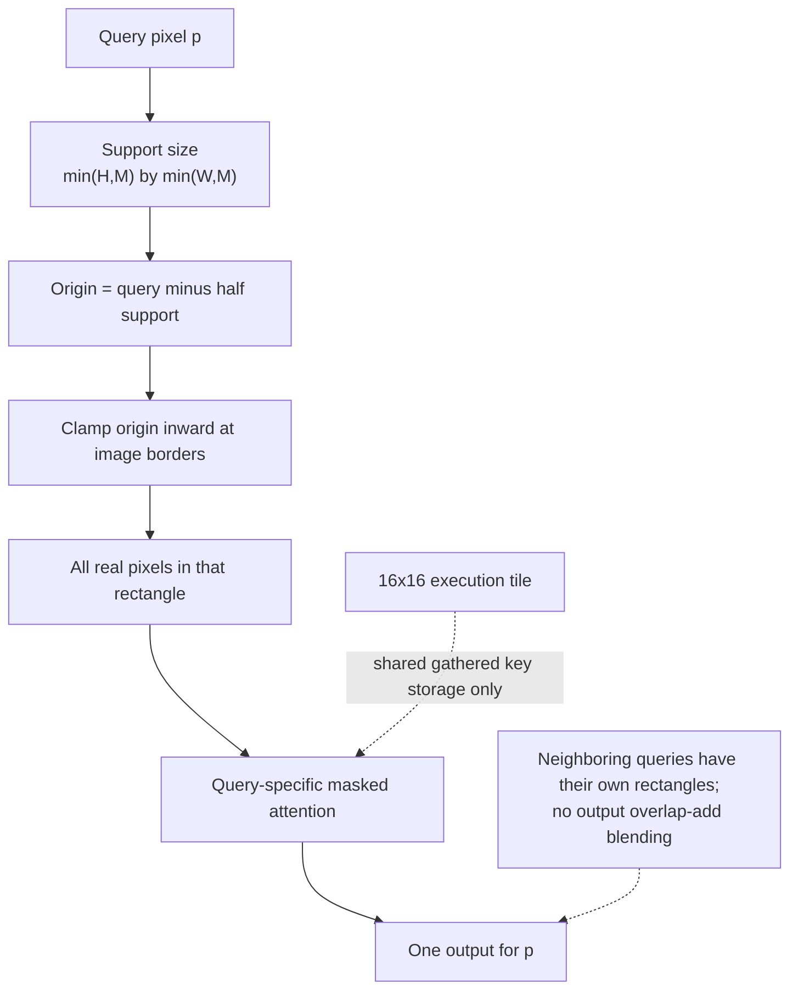
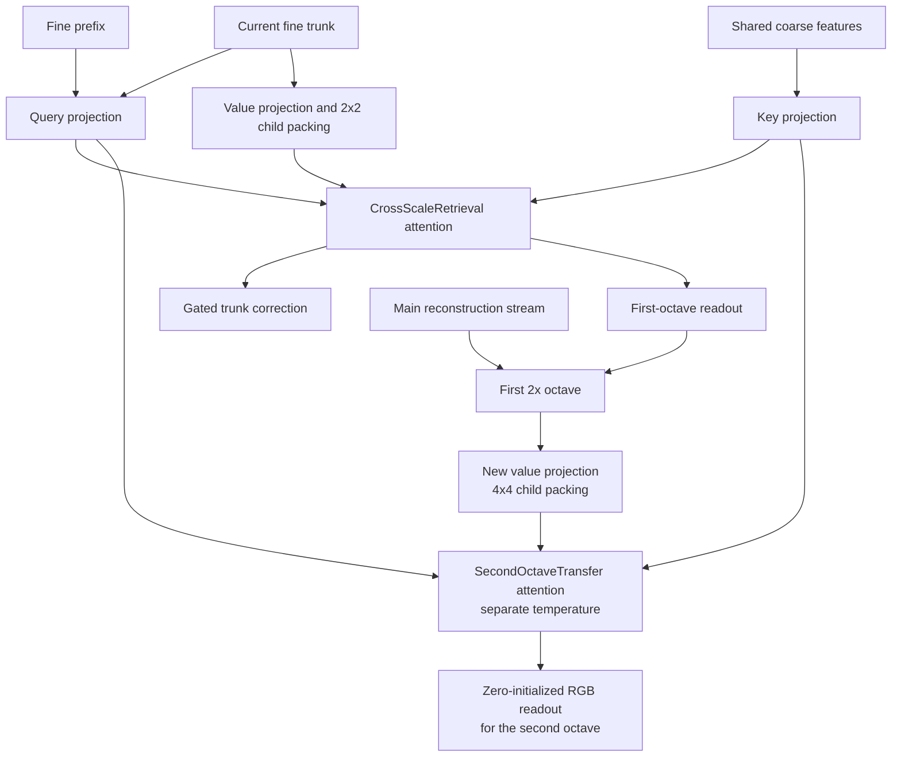
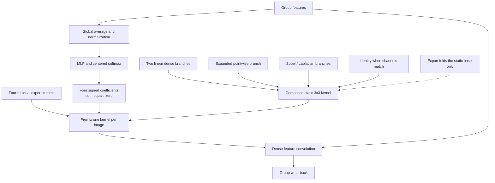

# DUAL: Neighborhood Context and Dynamic Kernel Mixing for Image Restoration

Rift73 | Technical report | 29 October 2026

[Typeset paper (PDF)](DUAL.pdf) · [Architecture](dual_arch.py) · [License](LICENSE)

Diagrams are embedded below; the PDF contains the typeset figures.

### Abstract

DUAL is a single-image restoration backbone that combines local spatial attention, per-query neighborhood context, regional channel mixing, cross-scale self-exemplar retrieval, and image-conditioned convolution. Local layers use anchored windows with tabulated relative position bias. Context layers use 32 x 32 and 64 x 64 in-bounds neighborhoods and a stationary Fourier bias represented through query/key factor concatenation. A separate regional operator blends channel interactions across four shifted grids. Cross-scale retrieval reuses a shallow encoder on a filtered coarse image and transfers packed values into the trunk and reconstruction stream. At each group exit, a centered router mixes residual kernels into a reparameterized static base before convolution. This report specifies the current six-preset implementation, its scale-dependent reconstruction, initialization, and training/export contracts. It updates the earlier anchored-context description to the current neighborhood-attention design; it does not report new quality or runtime experiments.

*Figure 1. DUAL data flow, with zero-based groups. CrossScaleRetrieval reads after group 1; SecondOctaveTransfer uses new values from the first reconstruction octave (a 2x spatial expansion). Arrows simplify residual and normalization paths.*

### 1  Design and scope

The name DUAL emphasizes complementary spatial and regional channel attention. The architecture separates three types of adaptation: spatial attention chooses relationships between locations, regional attention mixes channels, and a global image summary changes group-exit kernels. These mechanisms have different supports and cannot be treated as interchangeable forms of attention. The design draws on restoration transformers, rank-factorized bias, cross-scale self-similarity, and dynamic convolution [1-6].

This is a source-grounded technical report accompanying dual_arch.py, not a claim of state-of-the-art performance or a peer-reviewed publication. All figures are original schematics. The release contains architecture code rather than trained weights, a dataset, or a prescribed GAN training recipe.

## 2  Model family and residual hierarchy

For RGB input x of shape B x 3 x H x W and requested scale s in {1, 2, 4}, DUAL returns B x 3 x sH x sW. It subtracts the fixed RGB mean (0.4488, 0.4371, 0.4040), extracts stem features, processes residual groups, and adds a long stem skip after final token normalization and trunk convolution. The output combines the learned RGB residual with a nearest-neighbor image skip and restores the mean.

y = cropsH,sW [ Rs(x - μ) + NNs(x - μ) + μ ].   (1)

| Factory | C | Heads | Group depths | Layers | PU2 |
|---|---|---|---|---|---|
| dual_light | 128 | 4 | 4, 3, 3, 6 | 16 | Yes |
| dual_xs | 128 | 4 | 4, 3, 3, 6 | 16 | No |
| dual_s | 160 | 5 | 6 groups x 6 | 36 | No |
| dual_m | 192 | 6 | 6 groups x 6 | 36 | No |
| dual_l | 224 | 7 | 10 groups x 6 | 60 | No |
| dual_xl | 256 | 8 | 12 groups x 6 | 72 | No |

Table 1. Released preset geometry. Head width is 32 and reconstruction width is 64. Layer counts exclude the extra execution of the shared coarse-image prefix and are not parameter counts.

### 2.1  Local/context schedule

A full group follows [G16, shifted G16, C32, G16, shifted G16, C64], followed by a dynamic 3 x 3 write-back and a group residual. G16 denotes local spatial attention with a 16-pixel window; C32 and C64 denote context neighborhoods of width 32 and 64, not channel counts. G layers apply spatial attention and a convolutional feed-forward network. C layers insert regional channel attention between the spatial and feed-forward residuals. Light and XS retain original slot indices (0,1,2,3), (3,4,5), (0,1,2), and (0,1,2,3,4,5). They therefore retain 11 local and five context layers, including both context sizes.

### 2.2  Light input packing

Light rearranges 2 x 2 mean-shifted RGB neighborhoods into 12 channels before the stem. Its trunk grid is half the input resolution and its internal scale is 2s. The input is padded to a multiple of four, using reflection where legal and replication for very small dimensions, then cropped after reconstruction. XS has the same width and selected layers but does not pack the input. Consequently identical numeric window sizes refer to different input-pixel distances in Light and XS.

The raw DUAL constructor defaults to C96 with four full groups. It is not the Light preset. All six named factories support 1x/2x/4x; reconstruction weights are scale-specific.

## 3  Spatial attention and neighborhood context

Each spatial sublayer receives channel-normalized features. Its attention output is multiplied by a sigmoid gate computed with a depthwise 3 x 3 and pointwise convolution, then projected and added residually. Local G16 layers alternate unshifted and half-window-offset ownership. At a boundary, window origins are clamped inward; each output pixel still has one designated owner. Short axes use their available extent.

*Figure 2. Three different operations. Local and neighborhood attention mix spatial locations; regional attention instead builds channel-correlation matrices within regions. These are structural schematics, not measured attention maps.*

Ap = Σj ∈ S(p) softmaxj(qpkjT/√32 + B(p,j)) vj.   (2)

*Figure 3. Current context attention. Each pixel owns a distinct in-bounds support; execution tiles share gathered storage, not the output prediction.*

For context size M, define kH=min(H,M), kW=min(W,M), aY(p)=clamp(pY-floor(kH/2),0,H-kH), and the analogous aX. S(p) is the rectangle [aY,aY+kH) x [aX,aX+kW). Near an edge the rectangle shifts inward rather than filling with invalid padding. If both axes fit inside M, the implementation uses a single full-image window. Otherwise, 16 x 16 query tiles are processed four at a time. A shared key union is masked separately for every query to recover S(p) exactly.

### 3.1  What neighborhood attention changes

Unlike fixed context-window ownership, the donor support follows each query [3]. Unlike overlap-add inference, DUAL does not evaluate several predictions for a pixel and blend them. The 16-pixel execution grid is not a context partition: its masks preserve per-query support. This distinction removes one source of hard context ownership, but does not prove the full network is seam-free. Local windows, cross-scale blocks, convolution borders, and PU2 remain distinct sources of finite-image behavior.

context_na=True is the current default. context_overlap is a deprecated alias for this flag, not the former overlapping-window blending algorithm. Attention support is configuration, not a tensor encoded in the checkpoint.

## 4  Fourier bias and regional channel mixing

### 4.1  Stationary relative Fourier bias

The default context bias has rank 16: eight learned two-dimensional frequencies with per-head cosine and sine amplitudes. For phase φf(p)=ωfTp, define the following two-coordinate factors for each frequency. Their dot product depends only on displacement, including a signed directional component.

uf(p) = [af cos φ + bf sin φ, af sin φ - bf cos φ]
vf(p) = [cos φ, sin φ]
B(p,j) = Σf [af cos(ωfT(p-j)) + bf sin(ωfT(p-j))].   (3)

Concatenating [q/√32, u(p)] and [k, v(j)] turns content and bias into one dot product with attention scale set to one. This follows the factor-concatenation interface of RIB [1], but the default bias is an analytic Fourier parameterization, not a coordinate MLP. Frequency shapes do not depend on the window. Frequencies begin at log-spaced magnitudes from 2π/128 to π/2 with golden-angle directions; cosine amplitudes start at 1/8 and sine amplitudes at zero.

### 4.2  Regional channel attention

After each context spatial update, a separate channel mixer processes four 32 x 32 grids with offsets (0,0), (0,16), (16,0), and (16,16). Pointwise QKV and depthwise 3 x 3 projections produce per-head arrays of shape 32 x n. Channel correlations resemble transposed attention [4], but are computed regionally. With ε=10-6 and n real pixels, the normalized Gram is:

Gab = Σt QatKbt / [√(Σt Qat2 + nε) √(Σt Kbt2 + nε)]
O = softmax(exp(min(θ, ln 100)) G) V.   (4)

Gram products and softmax use FP32 for low-precision inputs, or FP64 for doubles. Probabilities are cast to the value dtype before multiplication. Separable hat weights blend the four outputs: ws(t)=1-|((t+s) mod 32)-15.5|/16. For integer pixels, w0+w16=1, so the four 2D products sum to one. This prevents gain changes from blending weights alone; learned regional outputs can still differ.

Finally, the expansion-two feed-forward residual applies H=GELU(W1z), then W2[H+GELU(DW3x3(H))]. Main-layer token normalization uses ε=10-5, with FP32 low-precision statistics. Regional mixing is not the same operation as context neighborhood attention.

## 5  Cross-scale self-exemplar retrieval

DUAL retrieves features within the input image across scales, rather than from another frame or external exemplar. Cross-scale self-similarity is a restoration precedent [5]. A coarse RGB image is formed by a fixed separable stride-two filter with taps [-3,-9,29,111,111,29,-9,-3]/256, replicated boundaries, and even-size handling. It reuses the same stem and first two local layers as the fine path.

*Figure 4. Origins and destinations of cross-scale features. CrossScaleRetrieval provides trunk and first-stage readouts. SecondOctaveTransfer reuses the query/key representations with its own temperature and new values from the first tail stage. The final image skip is omitted for clarity.*

The fine path records a prefix after these two layers and continues through the second group. A query projection receives normalized prefix and current features; keys are projected from normalized coarse features. Queries are grouped into blocks of up to 96 x 96 trunk positions with corresponding half-resolution key blocks. Equal-shaped blocks are batched. Retrieval is blockwise, not unrestricted image-wide attention.

Ph = softmax[τh λ(Nk) QhKhT],
λ(Nk) = ln Nk / (ln 1024 · √32),  0.1 ≤ τh ≤ 10.   (5)

### 5.1  CrossScaleRetrieval and SecondOctaveTransfer

CrossScaleRetrieval projects current fine features to C/4 channels. Packing four 2 x 2 child positions produces a 32-channel value vector per head and coarse key. The retrieved tensor supplies a gated trunk correction and, when internal upsampling exists, an unpacked readout into the first 2x reconstruction octave. Both output projections start at zero. This initially leaves the corresponding residual outputs inactive while allowing their readout parameters to learn.

For internal scales of at least four, SecondOctaveTransfer uses the same packed query/key representations but projects new values from that first octave, after its CrossScaleRetrieval readout. Sixteen child positions are packed per key, with two channels per child and head. SecondOctaveTransfer has its own temperature and zero-initialized RGB readout. It therefore does not simply reuse a previously computed attention probability matrix: its values are causally downstream, and its temperature can differ.

| Input path | Requested | Internal | First-stage readout | Second-stage RGB |
|---|---|---|---|---|
| Native | 1x | 1x | No | No |
| Native | 2x | 2x | Yes | No |
| Native | 4x | 4x | Yes | Yes |
| Light PU2 | 1x | 2x | Yes | No |
| Light PU2 | 2x | 4x | Yes | Yes |
| Light PU2 | 4x | 8x | Yes | Yes |

Table 2. Reconstruction regimes. CrossScaleRetrieval's trunk correction exists independently of its HR readout. Internal 8x uses an additional shuffle for the SecondOctaveTransfer output.

The key-count scaling in (5) changes logit magnitude, not donor identity. It does not establish equivalence between training crops and larger inference images.

## 6  Reparameterization and dynamic kernels

### 6.1  Edge-augmented reparameterized convolution

The source names its edge-augmented reparameterized convolution EDBB. Dense stride-one 3 x 3 sites use its factors: two independent gain-two 1x1-3x3-1x1 branches, an expanded pointwise path, Sobel-x/Sobel-y/Laplacian edge branches, and an identity when channels match. Depthwise and ordinary pointwise operators are not replaced. Structural reparameterization and edge-oriented branches have established precedents [7,8].

DUAL composes every branch differentiably in kernel space before applying the feature convolution. It does not materialize the gain-two intermediate feature maps. Composition uses FP32 for ordinary parameters and FP64 for double parameters, then casts back for convolution. The construction embeds the original dense operator at initialization in real arithmetic; additional factors can still change optimization. Parameter-space composition is not free: it adds arithmetic, storage, and autograd work.

### 6.2  Per-image group write-back

*Figure 5. Group-exit dynamic convolution. Static factors compose one base kernel; a global image summary supplies centered coefficients for four residual experts. The effective kernel is mixed before feature convolution. This is not selection among four nonlinear feature-processing networks.*

Each group exit adds four zero-initialized residual kernels to the static base. A router forms FP32/FP64 global averages, applies non-affine LayerNorm, and uses a C-to-C/4-to-4 MLP with GELU. The softmax is centered around the uniform mixture, yielding signed coefficients shared across the image.

c(x) = softmax(MLP(LN(GAP(x)))) - 1/K,  K=4
W(x) = W0 + Σk ck(x)Ek,   y = Conv(x; W(x), b0).   (6)

Convolution is linear in its kernel, so premixing is algebraically equivalent to summing the base response and coefficient-weighted expert responses. For B>1, the implementation packs samples into a convolution with groups=B and then restores the batch. These groups isolate images; the channel convolution remains dense. This is continuous kernel mixing, not sparse top-k routing among nonlinear networks [6].

Initially Ek=0, so the dynamic correction vanishes. Expert gradients can differ through ck, while the router's data gradient through this zero bank initially vanishes. Because Σck=0, adding one common kernel to every expert changes nothing. This is a contrast-space redundancy, not a rank bound on the effective convolution.

### 6.3  What deployment can fold

prepare_for_export() folds static factors in FP64 on an eval copy and retains input-dependent routing and experts. Freezing a mixed kernel observed on one image would change the model. Folding removes the training parameterization and is not a reversible training operation. Algebraic equivalence does not imply bitwise equality after low-precision casts or backend changes.

## 7  Training execution and deployment

| Option | Default | Role |
|---|---|---|
| context_na | True | Per-query context support |
| use_checkpoint | True | Rematerialize complete residual layers |
| context_checkpoint | True | Selective context gather/bias/mask rematerialization |
| dual_core_checkpoint | False | Optional regional channel-core rematerialization |
| g_attention_impl | sdpa | Eager local attention path |
| compile_g_attention_impl | direct | Eligible local path after preparation |

Table 3. Current model defaults. Activation checkpointing is distinct from saving training state. Explicit configuration overrides remain effective.

prepare_for_compile(input_shape, input_dtype) selects execution paths by capability, not preset name or requested scale. In undeployed training with FP16/BF16 inputs, eligible full G16/G32 anchored dot-product layers can use the bundled dense-relative-bias Triton backend. Device, shape, dtype, mask, and mode are checked again at the call site. Unsupported geometry routes to SDPA with a warning; missing direct dependencies are reported when direct execution is requested.

For eligible BF16 context training, images are folded into the head dimension so one tile mask is shared across images. Query/key width is 32+16, while the value width remains 32. The standard layout pads values with zero factor lanes and slices them afterward. Both layouts select the same neighborhoods and relative coordinates. CUDA, dtype, training state, deterministic-mode setting, and backend availability govern actual execution; a family-wide policy is not a universal GPU compatibility or speed guarantee.

### 7.1  Selective rematerialization

Image-wide QKV projection and output assembly stay outside the selective context checkpoint. Gathered tensors, positional factors, and masks can be regenerated; named fused SDPA outputs are retained by policy. If another attention backend is selected, the memory/recomputation behavior can differ. Whole-layer and context checkpointing may coexist, so the tradeoff must be measured in the actual training graph rather than inferred from a flag alone.

### 7.2  Release and export boundary

The architecture file bundles its optional direct kernels and can import without traiNNer. PyTorch supplies SDPA and checkpoint APIs; optional Triton and torch.library APIs enable the direct path. Export preparation resets spatial routing to SDPA and disables the BF16 training layout before folding. The method prepares a model copy; it does not itself produce ONNX, a TensorRT engine, or a hardware-specific plugin. FlashAttention-style interfaces do not prove a particular fused backend was launched [9].

Call model.eval(), make a separate deep copy, then call prepare_for_export() on that copy. The DUAL method returns None. Keep the unfolded model and checkpoint for training or resumption.

## 8  Reproducibility, changes, and limitations

### 8.1  What changed from the earlier report

The October 8 description used anchored ownership for context windows. The present default instead uses exact per-query neighborhoods with inward-shifted boundary support. Local G attention remains anchored. Regional channel attention still blends four shifted grids; that blending should not be confused with the removed overlap-add context approach. The execution policy now covers all six presets and all three scales through capability checks. Whole-layer and selective context checkpointing default on; regional core checkpointing defaults off.

### 8.2  Checkpoint and integration contract

Select the correct factory, requested scale, and structural options before loading an unfolded state dictionary. Load strictly when the intended architecture matches. Non-tensor settings such as context_na and window sizes are not fully described by parameter shapes. A successful load therefore proves matching keys/shapes, not equivalence to the function used to train an older checkpoint. Save architecture configuration alongside weights. The published family has Light, XS, S, M, L, and XL; no retired legacy preset is included.

For traiNNer integration, place the single file in traiNNer/archs and select its registered factory in network_g. Avoid simultaneously importing an older module that registers the same names. Keep precision, color convention, output clipping, padding, and tiling choices explicit in inference tooling. The architecture itself does not clamp its RGB output to a display range.

### 8.3  Finite-image and numerical limits

Neighborhood context is bounded; it is not global attention. PU2 changes phase handling and the relation between trunk pixels and input pixels. Local-window ownership, cross-scale block boundaries, convolution padding, and image-wide routing prevent a blanket claim of exact translation equivariance. Independently tiled inference changes both available donors and routing statistics, so it is not generally identical to whole-image inference. Parameter-compatible changes to support can also change texture behavior.

Kernel composition, factor concatenation, and layout changes are described algebraically. Floating-point accumulation order and casts can produce different results, gradients, and subsequent training trajectories. This report provides no new PSNR, SSIM, perceptual-quality, latency, or peak-memory measurements. Neither the absence of a fixed context partition nor a successful export is proof of artifact-free restoration.

### 8.4  Evaluation requirements

A quantitative study should disclose the dataset/degradation, loss stack, crop, effective batch, optimizer, schedule, seeds, checkpoint selection, color/crop convention, and matched visual examples. Runtime reporting should specify device, software versions, precision, shape, batch, backend, folding, tiling, warmup, and timing scope. Separate training cost from folded inference cost. Such measurements remain future evidence, not results supplied by this architectural description.

### 8.5  Terminology guide

| Notation | Meaning |
|---|---|
| NA | Neighborhood attention: one donor neighborhood per query pixel. |
| G16 / C32 / C64 | Local window 16 / context neighborhood 32 or 64. |
| RFB / RPB | Relative Fourier bias / tabulated relative position bias. |
| PU2 / F64 | PixelUnshuffle by 2 / reconstruction width of 64 channels. |
| Q / K / V | Query / key / value projections; their origins are specified for each operator. |
| Octave | One 2x spatial-resolution step, not an extra video frame. |

### Implementation and attribution

The accompanying dual_arch.py is the source of truth for this release. This paper contains the architecture explanation, diagrams, and integration notes. Applicable code notices are consolidated in LICENSE. References credit the specific methods discussed; their benchmark results are not transferred to DUAL.

Author: Rift73. Documentation and original schematic preparation were assisted by Codex, with a visual-design review by Claude Opus 5.5. This technical report accompanies the architecture source in PDF and Markdown formats.

## References

[1] D. Lee, S. Yun, J. Im, and Y. Ro. Rank-Factorized Implicit Neural Bias: Scaling Super-Resolution Transformer with FlashAttention. 2026. [arXiv:2603.06738](https://arxiv.org/abs/2603.06738). Factor-concatenation and cyclic local/context attention antecedents.

[2] J. Liang et al. SwinIR: Image Restoration Using Swin Transformer. ICCV Workshops, 2021. [arXiv:2108.10257](https://arxiv.org/abs/2108.10257). Windowed restoration transformer context.

[3] A. Hassani et al. Neighborhood Attention Transformer. CVPR, 2023. [arXiv:2204.07143](https://arxiv.org/abs/2204.07143). Sliding per-query neighborhood attention; DUAL does not depend on NATTEN.

[4] S. W. Zamir et al. Restormer: Efficient Transformer for High-Resolution Image Restoration. CVPR, 2022. [arXiv:2111.09881](https://arxiv.org/abs/2111.09881). Channel/transposed attention antecedent.

[5] Y. Mei et al. Image Super-Resolution with Cross-Scale Non-Local Attention and Exhaustive Self-Exemplars Mining. CVPR, 2020. [arXiv:2006.01424](https://arxiv.org/abs/2006.01424). Cross-scale self-exemplar motivation.

[6] Y. Chen et al. Dynamic Convolution: Attention over Convolution Kernels. CVPR, 2020. [arXiv:1912.03458](https://arxiv.org/abs/1912.03458). Input-dependent kernel aggregation.

[7] X. Ding, X. Zhang, J. Han, and G. Ding. Diverse Branch Block: Building a Convolution as an Inception-like Unit. CVPR, 2021. [arXiv:2103.13425](https://arxiv.org/abs/2103.13425). Structural reparameterization.

[8] X. Zhang, H. Zeng, and L. Zhang. Edge-oriented Convolution Block for Real-time Super Resolution on Mobile Devices. ACM Multimedia, 2021. [Official ECBSR repository](https://github.com/xindongzhang/ECBSR). Edge-oriented linear branches.

[9] T. Dao et al. FlashAttention: Fast and Memory-Efficient Exact Attention with IO-Awareness. NeurIPS, 2022. [arXiv:2205.14135](https://arxiv.org/abs/2205.14135). Attention execution and IO considerations.
