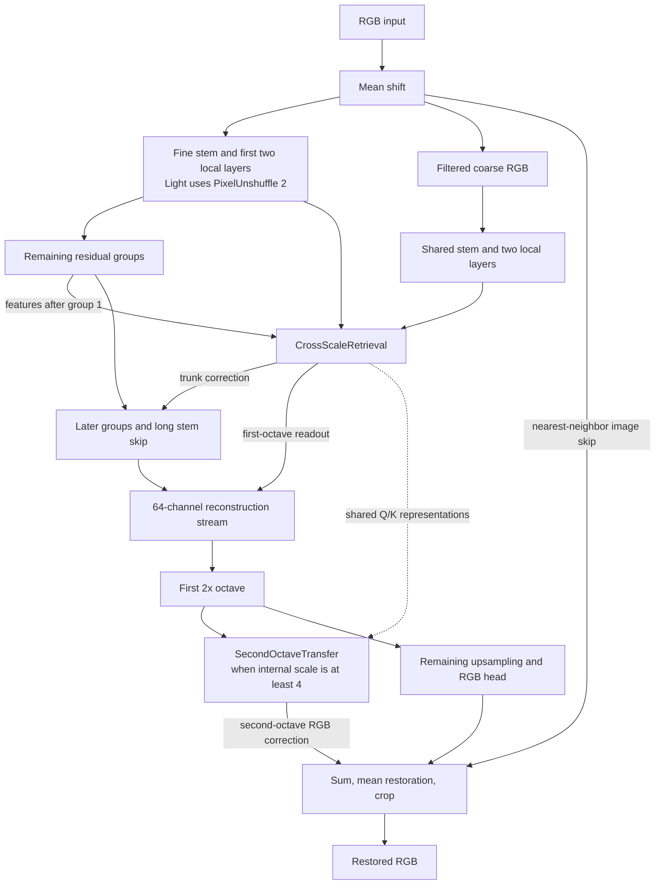
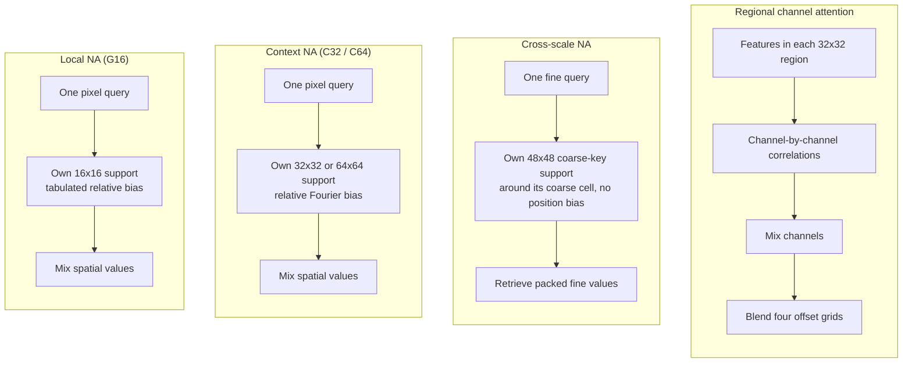
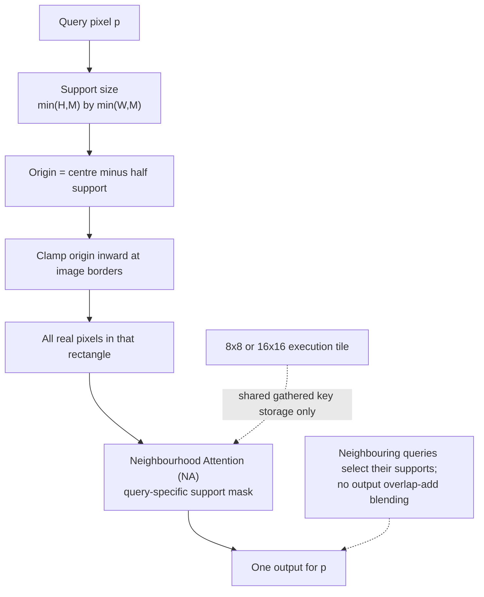
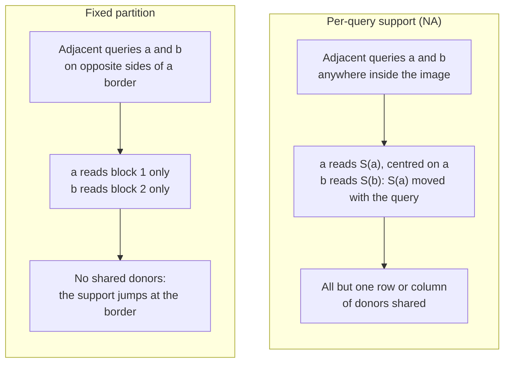
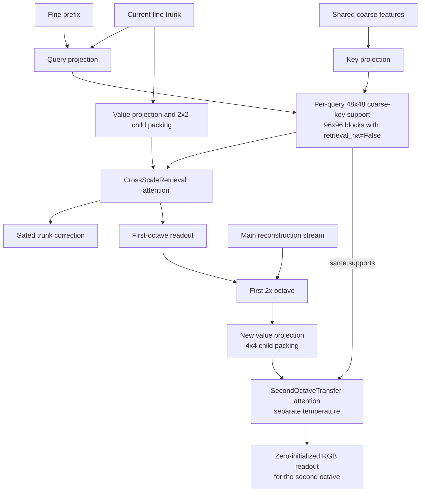
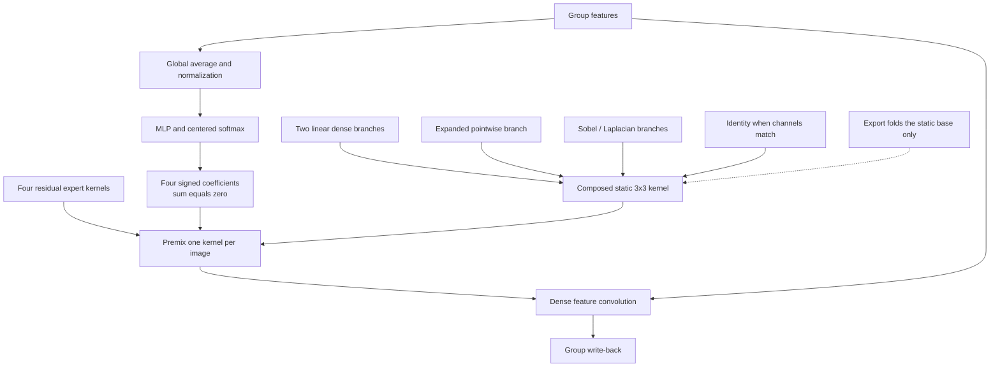

# DUAL: Neighbourhood Attention and Dynamic Kernel Mixing for Image Restoration

Rift73 | Technical report | 14 November 2026

[Typeset paper (PDF)](DUAL.pdf) · [Architecture](dual_arch.py) · [License](LICENSE)

Diagrams are embedded below; the PDF contains the typeset figures.

### Abstract

DUAL is a single-image restoration backbone whose spatial attention is Neighbourhood Attention (NA) throughout: every query attends to its own in-bounds rectangle of keys. Local layers use 16 x 16 neighbourhoods with tabulated relative position bias. Context layers use 32 x 32 or 64 x 64 neighbourhoods with stationary Fourier bias represented through query/key factor concatenation. Cross-scale self-exemplar retrieval reuses a shallow encoder on a filtered coarse image: each fine query attends to a 48 x 48 neighbourhood of coarse keys without position bias, and the retrieved packed values are transferred into the trunk and the reconstruction stream. A separate regional operator blends channel interactions across four shifted grids. At each group exit, a centered router mixes residual kernels into a reparameterized static base before convolution. Six presets support 1x, 2x, and 4x restoration. This report details their architecture, scale-dependent reconstruction, initialization, and training and deployment behavior.

*Figure 1. DUAL data flow, with zero-based groups. CrossScaleRetrieval reads after group 1; SecondOctaveTransfer uses new values from the first reconstruction octave (a 2x spatial expansion). Arrows simplify residual and normalization paths.*

### 1  Design rationale

The name DUAL emphasizes complementary spatial and regional channel attention. The architecture separates three types of adaptation: spatial attention chooses relationships between locations, regional attention mixes channels, and a global image summary changes group-exit kernels. These mechanisms have different supports and cannot be treated as interchangeable forms of attention. The design draws on restoration transformers, rank-factorized bias, cross-scale self-similarity, and dynamic convolution [1-6].

All spatial operators follow one support rule: each query reads a rectangle placed around its own position and shifted inward at image borders (Section 3.1). A fixed partition instead assigns queries to windows or blocks at positions fixed in the image, so adjacent queries on opposite sides of a border read different, generally disjoint, donor sets. The 96-position retrieval partition has no border inside a training crop of at most 96 trunk positions per axis (96 input pixels natively, 192 with PixelUnshuffle 2), so its borders are first met on larger inference images. Per-query supports have no positions of this kind. This is a property of the supports, not a measured result.

## 2  Model family and residual hierarchy

For RGB input x of shape B x 3 x H x W and requested scale s in {1, 2, 4}, DUAL returns B x 3 x sH x sW. It subtracts the fixed RGB mean (0.4488, 0.4371, 0.4040), extracts stem features, processes residual groups, and adds a long stem skip after final token normalization and trunk convolution. The output combines the learned RGB residual with a nearest-neighbor image skip and restores the mean.

y = cropsH,sW [ Rs(x - μ) + NNs(x - μ) + μ ].   (1)

| Factory | C | Heads | Group depths | Layers | PU2 |
|---|---|---|---|---|---|
| dual_light | 128 | 4 | 4, 3, 3, 6 | 16 | Yes |
| dual_xs | 128 | 4 | 4, 3, 3, 6 | 16 | No |
| dual_s | 160 | 5 | 6 groups x 6 | 36 | No |
| dual_m | 192 | 6 | 6 groups x 6 | 36 | No |
| dual_l | 224 | 7 | 10 groups x 6 | 60 | No |
| dual_xl | 256 | 8 | 12 groups x 6 | 72 | No |

Table 1. Released preset geometry. Head width is 32 and reconstruction width is 64. Layer counts exclude the extra execution of the shared coarse-image prefix and are not parameter counts.

### 2.1  Local/context schedule

A full group follows the slots [G16, shifted G16, C32, G16, shifted G16, C64], followed by a dynamic 3 x 3 write-back and a group residual. G16 denotes a local layer with 16 x 16 spatial support; C32 and C64 denote context layers with 32 x 32 and 64 x 64 support. The numbers are support widths, not channel counts, and "shifted" names a slot whose ownership offset matters only for the fixed windows of Section 3.3. G layers apply spatial attention and a convolutional feed-forward network. C layers insert regional channel attention between the NA and feed-forward residuals. Light and XS retain original slot indices (0,1,2,3), (3,4,5), (0,1,2), and (0,1,2,3,4,5). They therefore retain 11 local and five context layers, including both context sizes. The three switches context_na, local_na and retrieval_na are on by default for all six presets and all supported output scales.

### 2.2  Light input packing

Light rearranges 2 x 2 mean-shifted RGB neighborhoods into 12 channels before the stem. Its trunk grid is half the input resolution and its internal scale is 2s. The input is padded to a multiple of four, using reflection where legal and replication for very small dimensions, then cropped after reconstruction. XS has the same width and selected layers but does not pack the input. Consequently identical numeric support sizes refer to different input-pixel distances in Light and XS.

The raw DUAL constructor defaults to C96 with four full groups. It is not the Light preset. All six named factories support 1x/2x/4x; reconstruction weights are scale-specific.

## 3  Neighbourhood Attention

Neighbourhood Attention (NA) is query-centred spatial attention [3]: each query selects an in-bounds donor rectangle around its own position, instead of sharing a window with the other queries of a fixed partition. DUAL applies this rule in all three of its spatial attention operators, and its implementation does not require the NATTEN library. Each local and context spatial sublayer receives channel-normalized features. Its attention output is multiplied by a sigmoid gate computed with a depthwise 3 x 3 and pointwise convolution, then projected and added residually.

*Figure 2. Four different operations. The three NA operators mix spatial locations, each query over its own support: local layers with tabulated relative position bias, context layers with relative Fourier bias, and cross-scale retrieval over half-resolution keys without position bias. Regional attention instead builds channel-correlation matrices within regions. These are structural schematics, not measured attention maps.*

### 3.1  The support rule

Ap = Σj ∈ S(p) softmaxj(qpkjT/√32 + B(p,j)) vj.   (2)

*Figure 3. The support rule. Each query selects an in-bounds support that follows its position and shifts inward at borders. Adjacent supports may coincide near an edge. Execution tiles share gathered storage, not output predictions.*

For support size M on a key grid of H x W positions, define kH=min(H,M), kW=min(W,M), aY(p)=clamp(cY(p)-floor(kH/2),0,H-kH), and the analogous aX. S(p) is the rectangle [aY,aY+kH) x [aX,aX+kW). For the local and context operators the centre is the query itself, c(p)=p, and queries and keys share one grid. For cross-scale retrieval, H and W are the coarse grid sizes, M=48, and the centre is the query's coarse cell, c(p)=(floor(pY/2), floor(pX/2)). Near an edge the rectangle shifts inward rather than filling with invalid padding, and an axis shorter than M contributes its whole length. Equation (2) gives the local and context operators; cross-scale retrieval uses the same S(p) with the logits of (5).

### 3.2  Three uses of the rule

| Operator | Switch | Queries | Keys | Support | Position term B | Single window or block when |
|---|---|---|---|---|---|---|
| Local (G16) | local_na | Trunk positions | Same map | 16 x 16 around p | Tabulated RPB by query-minus-key offset | Both axes at most 16 |
| Context (C32 / C64) | context_na | Trunk positions | Same map | 32 x 32 or 64 x 64 around p | Relative Fourier bias, Section 4.1 | Both axes at most M |
| Cross-scale | retrieval_na | Even-padded fine trunk positions | Half-resolution coarse features | 48 x 48 coarse keys around the coarse cell of p | None; temperature and key-count scale, Section 5 | Both coarse axes at most 48 (trunk at most 96) |

Table 2. One support rule in three operators. At or below the stated size the map is one window or block, which equals the NA support there; the code then attends that window without a support mask.

In a local layer the bias of query p and key j is read from the layer's (2 x 16 - 1)2-entry table at the offset p - j, the same table and indexing as for an owned window. Because every query is centred by the rule, the alternating shift of slots 1 and 4 has no effect when local_na=True; it applies only to the owned windows of Section 3.3. NA in local layers requires dot-product attention (qk='dot'); context NA additionally requires the Fourier bias.

### 3.3  Fixed partitions and what NA replaces

Each switch set to False restores a fixed partition; for local_na and retrieval_na this is the behavior before this revision. local_na=False gives owned 16 x 16 windows: segments start at -o + 16k, with o=0 in slots 0 and 3 and o=8 in the shifted slots 1 and 4. Window origins are clamped inward at a boundary, so the last window reads further into the image, but each output pixel still has one designated owner. context_na=False gives anchored M x M context windows with o=0. retrieval_na=False groups trunk positions into blocks of 96 x 96, each reading the corresponding 48 x 48 half-resolution key block; an axis of length L above 96 that is not a multiple of 96 ends in a remainder block of L mod 96 positions with proportionally fewer keys, and equal-shaped blocks are batched.

The borders of these partitions are fixed in the image. Local ownership borders lie at 16k trunk positions in slots 0 and 3 and at 8 + 16k in slots 1 and 4: every 16 input pixels natively and every 32 with PU2, offset by half a window (8 or 16 input pixels) in alternate layers. Anchored context borders lie at multiples of M trunk positions (M input pixels natively, 2M with PU2). Retrieval block borders lie at multiples of 96 trunk positions: 96 input pixels natively and 192 with PU2.

The local and retrieval cases differ in kind. Local borders move by half a window between alternate layers, and every crop longer than 16 trunk positions on an axis contains them, so they are present throughout training. The retrieval supports are formed once per forward pass, with borders at fixed multiples of the block size; a crop of at most 96 trunk positions per axis is a single block and contains none, so these borders first appear on larger images.

*Figure 4. Fixed partition versus per-query support. Under a fixed partition, adjacent queries a and b on opposite sides of a border read disjoint blocks, and the support jumps by a whole block. Under NA the support of b is the support of a moved by one position, so an M x M support shares all but one row or column of donors. At image borders the clamped supports of neighbouring queries coincide. In the cross-scale case the coarse centre advances once per two fine positions, so adjacent fine queries share their whole support or all but one coarse row or column.*

### 3.4  Execution tiles

| Operator | Query tile | Key union gathered per tile | Keys each query needs | Ratio |
|---|---|---|---|---|
| Local NA (G16) | 8 x 8 | 23 x 23 | 16 x 16 | 2.07 |
| Context NA (C32) | 16 x 16 | 47 x 47 | 32 x 32 | 2.16 |
| Context NA (C64) | 16 x 16 | 79 x 79 | 64 x 64 | 1.52 |
| Cross-scale NA | 8 x 8 fine | 51 x 51 coarse | 48 x 48 coarse | 1.13 |

Table 3. Gathered key unions away from image borders. The union per axis is the support width plus the spread of the tile's support origins: 7 for an 8-position tile at unit stride, 15 for a 16-position tile, and 3 for an 8-position fine tile over half-resolution keys. The ratio is gathered keys divided by keys needed; a fixed partition of the same support size gathers exactly the keys it needs, so the ratio is also NA's query-key pair count relative to that partition.

Context NA processes up to four 16 x 16 tiles per attention call. Local and cross-scale NA batch as many 8 x 8 tiles per call as fit a fixed element budget. Tiles of the same border class share one mask. Tiles and chunks are execution details, not heads or a change to the neighbourhood size: a per-query mask over the shared key union recovers S(p) exactly. In local layers that mask also carries the tabulated bias, with -∞ outside S(p).

### 3.5  What NA changes

The attention weights depend on query/key content and relative position; NA is not a fixed smoothing filter. Overlap occurs between donor neighbourhoods, not between separately predicted outputs. With the default switches, no spatial attention operator has a partition border inside the image. Other components retain their own boundary behavior: convolution borders, PU2, the regional mixer's blended windows, and per-image routing. NA complements these components rather than replacing them.

NA specifies which pixels can interact. SDPA and FlexAttention specify how that attention is executed. The optional Flex path preserves the same per-query support and learned Fourier factors; enabling it is not an architectural switch from window attention to NA. Backend changes can nevertheless alter floating-point rounding, latency, and memory use.

## 4  Fourier bias and regional channel mixing

### 4.1  Stationary relative Fourier bias

The default context bias has rank 16: eight learned two-dimensional frequencies with per-head cosine and sine amplitudes. For phase φf(p)=ωfTp, define the following two-coordinate factors for each frequency. Their dot product depends only on displacement, including a signed directional component.

uf(p) = [af cos φ + bf sin φ, af sin φ - bf cos φ]
vf(p) = [cos φ, sin φ]
B(p,j) = Σf [af cos(ωfT(p-j)) + bf sin(ωfT(p-j))].   (3)

Concatenating [q/√32, u(p)] and [k, v(j)] turns content and bias into one dot product with attention scale set to one. This follows the factor-concatenation interface of RIB [1], but the default bias is an analytic Fourier parameterization, not a coordinate MLP. Frequency shapes do not depend on the window. Frequencies begin at log-spaced magnitudes from 2π/128 to π/2 with golden-angle directions; cosine amplitudes start at 1/8 and sine amplitudes at zero.

### 4.2  Regional channel attention

After each context spatial update, a separate channel mixer processes four 32 x 32 grids with offsets (0,0), (0,16), (16,0), and (16,16). Pointwise QKV and depthwise 3 x 3 projections produce per-head arrays of shape 32 x n. Channel correlations resemble transposed attention [4], but are computed regionally. With ε=10-6 and n real pixels, the normalized Gram is:

Gab = Σt QatKbt / [√(Σt Qat2 + nε) √(Σt Kbt2 + nε)]
O = softmax(exp(min(θ, ln 100)) G) V.   (4)

Gram products and softmax use FP32 for low-precision inputs, or FP64 for doubles. Probabilities are cast to the value dtype before multiplication. Separable hat weights blend the four outputs: ws(t)=1-|((t+s) mod 32)-15.5|/16. For integer pixels, w0+w16=1, so the four 2D products sum to one. This prevents gain changes from blending weights alone; learned regional outputs can still differ. The regional mixer keeps a fixed partition, softened by blending four offset grids, rather than a per-position support.

Finally, the expansion-two feed-forward residual applies H=GELU(W1z), then W2[H+GELU(DW3x3(H))]. Main-layer token normalization uses ε=10-5, with FP32 low-precision statistics. Regional channel mixing is separate from spatial Neighbourhood Attention.

## 5  Cross-scale self-exemplar retrieval

DUAL retrieves features within the input image across scales, rather than from another frame or external exemplar. Cross-scale self-similarity is a restoration precedent [5]. A coarse RGB image is formed by a fixed separable stride-two filter with taps [-3,-9,29,111,111,29,-9,-3]/256, replicated boundaries, and even-size handling. It reuses the same stem and first two local layers as the fine path.

*Figure 5. Origins and destinations of cross-scale features. Each fine query reads its own 48 x 48 coarse-key support. CrossScaleRetrieval provides trunk and first-stage readouts. SecondOctaveTransfer reuses the query/key representations and their supports with its own temperature and new values from the first tail stage. The final image skip is omitted for clarity.*

The fine path records a prefix after these two layers and continues through the second group. A query projection receives normalized prefix and current features, padded to even size; keys are projected from normalized coarse features.

By default (retrieval_na=True), each fine query p attends to its own 48 x 48 neighbourhood of coarse keys centred on its coarse cell (floor(pY/2), floor(pX/2)), placed by the support rule of Section 3.1 and shifted inward at borders. There is no position bias. With retrieval_na=False, queries are instead grouped into fixed blocks of 96 x 96 trunk positions, each reading only the corresponding half-resolution key block (Section 3.3).

Both settings share the following. A coarse grid of at most 48 positions per axis, that is a trunk of at most 96, is a single block whose keys are the whole coarse grid; the two settings are then identical. SecondOctaveTransfer follows the same choice, because it receives the packed query/key tuple of CrossScaleRetrieval. Under either setting retrieval is bounded, not unrestricted image-wide attention.

Ph = softmax[τh λ(Nk) QhKhT],
λ(Nk) = ln Nk / (ln 1024 · √32),  0.1 ≤ τh ≤ 10.   (5)

Nk is the number of keys each query reads. With retrieval_na=True it is min(Hc,48) · min(Wc,48) for a coarse grid Hc x Wc, so 2304 whenever both coarse axes reach 48, and the softmax runs over that support under a per-query mask. With retrieval_na=False it is the key count of each block, (wH/2)(wW/2) for a block of wH x wW trunk positions: 2304 for a full 96 x 96 block and fewer for remainder blocks.

### 5.1  CrossScaleRetrieval and SecondOctaveTransfer

CrossScaleRetrieval projects current fine features to C/4 channels. Packing four 2 x 2 child positions produces a 32-channel value vector per head and coarse key. The retrieved tensor supplies a gated trunk correction and, when internal upsampling exists, an unpacked readout into the first 2x reconstruction octave. Both output projections start at zero. This initially leaves the corresponding residual outputs inactive while allowing their readout parameters to learn.

For internal scales of at least four, SecondOctaveTransfer uses the same packed query/key representations but projects new values from that first octave, after its CrossScaleRetrieval readout. Sixteen child positions are packed per key, with two channels per child and head. SecondOctaveTransfer has its own temperature and zero-initialized RGB readout. It therefore does not simply reuse a previously computed attention probability matrix: its values are causally downstream, and its temperature can differ.

| Input path | Requested | Internal | First-stage readout | Second-stage RGB |
|---|---|---|---|---|
| Native | 1x | 1x | No | No |
| Native | 2x | 2x | Yes | No |
| Native | 4x | 4x | Yes | Yes |
| Light PU2 | 1x | 2x | Yes | No |
| Light PU2 | 2x | 4x | Yes | Yes |
| Light PU2 | 4x | 8x | Yes | Yes |

Table 4. Reconstruction regimes. CrossScaleRetrieval's trunk correction exists independently of its HR readout. Internal 8x uses an additional shuffle for the SecondOctaveTransfer output.

The key-count scaling in (5) changes logit magnitude, not donor identity. It does not establish equivalence between training crops and larger inference images.

## 6  Reparameterization and dynamic kernels

### 6.1  Edge-augmented reparameterized convolution

DUAL uses edge-augmented reparameterized convolution (EDBB) at dense stride-one 3 x 3 sites: two independent gain-two 1x1-3x3-1x1 branches, an expanded pointwise path, Sobel-x/Sobel-y/Laplacian edge branches, and an identity when channels match. Depthwise and ordinary pointwise operators are not replaced. Structural reparameterization and edge-oriented branches have established precedents [7,8].

DUAL composes every branch differentiably in kernel space before applying the feature convolution. It does not materialize the gain-two intermediate feature maps. Composition uses FP32 for ordinary parameters and FP64 for double parameters, then casts back for convolution. The construction embeds the original dense operator at initialization in real arithmetic; additional factors can still change optimization. Parameter-space composition is not free: it adds arithmetic, storage, and autograd work.

### 6.2  Per-image group write-back

*Figure 6. Group-exit dynamic convolution. Static factors compose one base kernel; a global image summary supplies centered coefficients for four residual experts. The effective kernel is mixed before feature convolution. This is not selection among four nonlinear feature-processing networks.*

Each group exit adds four zero-initialized residual kernels to the static base. A router forms FP32/FP64 global averages, applies non-affine LayerNorm, and uses a C-to-C/4-to-4 MLP with GELU. The softmax is centered around the uniform mixture, yielding signed coefficients shared across the image.

c(x) = softmax(MLP(LN(GAP(x)))) - 1/K,  K=4
W(x) = W0 + Σk ck(x)Ek,   y = Conv(x; W(x), b0).   (6)

Convolution is linear in its kernel, so premixing is algebraically equivalent to summing the base response and coefficient-weighted expert responses. For B>1, the implementation packs samples into a convolution with groups=B and then restores the batch. These groups isolate images; the channel convolution remains dense. This is continuous kernel mixing, not sparse top-k routing among nonlinear networks [6].

Initially Ek=0, so the dynamic correction vanishes. Expert gradients can differ through ck, while the router's data gradient through this zero bank initially vanishes. Because Σck=0, adding one common kernel to every expert changes nothing. This is a contrast-space redundancy, not a rank bound on the effective convolution.

### 6.3  What deployment can fold

prepare_for_export() folds static factors in FP64 on an eval copy and retains input-dependent routing and experts. Freezing a mixed kernel observed on one image would change the model. Folding removes the training parameterization and is not a reversible training operation. Algebraic equivalence does not imply bitwise equality after low-precision casts or backend changes.

## 7  Training execution and deployment

| Option | Default | Role |
|---|---|---|
| context_na | True | NA in context layers; False restores anchored windows |
| local_na | True | NA in local G16 layers; False restores owned windows |
| retrieval_na | True | Cross-scale NA; False restores 96 x 96 trunk blocks |
| use_checkpoint | True | Selective whole-layer activation checkpointing |
| attn_type | masked | SDPA for NA; hybrid opts into eligible compiled Flex calls |
| g_attention_impl | sdpa | Eager local attention path |
| compile_g_attention_impl | direct | Eligible fixed-window local path after preparation (local_na=False only) |

Table 5. Effective execution defaults for all presets and scales. Section 3.3 details the fixed partitions that the three switches restore. Activation checkpointing is distinct from saving training state. NA remains enabled under both attention backend choices.

Local NA and cross-scale NA have one execution path in every mode: index gathers and masked SDPA, in eager execution, after prepare_for_compile, with attn_type=hybrid, in evaluation, and after prepare_for_export. FlexAttention replaces only eligible context NA calls (Section 7.1).

prepare_for_compile(input_shape, input_dtype) configures an undeployed training model using capability checks shared by every preset and output scale. With FP16/BF16 inputs, eligible full G16/G32 anchored dot-product layers can use the bundled dense-relative-bias Triton kernel; it implements fixed windows, so it is selected only for layers with local_na=False. Device, dtype, geometry, and mask checks still apply at execution. Unsupported local geometry routes to SDPA with a warning; missing direct-kernel dependencies are reported rather than silently ignored. Setting compile_g_attention_impl to sdpa keeps local attention on SDPA.

For eligible CUDA BF16 context training with deterministic algorithms disabled, images are folded into the head dimension so one tile mask is shared across images. With attn_type=masked, this path uses SDPA and prefers cuDNN attention, then efficient attention or the math implementation according to backend support. The 32 content channels and 16 Fourier lanes give Q/K width 48, while V stays at width 32. The standard layout instead zero-pads V and slices the result. These layouts preserve the same neighbourhoods and relative coordinates.

### 7.1  Optional FlexAttention backend

attn_type=hybrid replaces only eligible masked NA calls during compiled CUDA BF16 training. The Flex path requires context_na=True, the PyTorch FlexAttention/Triton backend, rank-16 Fourier bias, a 32- or 64-pixel context, and deterministic algorithms disabled. The same four-tile geometry is encoded in a BlockMask; Q/K are zero-padded from width 48 to 64 and V remains width 32. Learned Fourier factors remain differentiable Q/K operands. Local attention, in either setting, and cross-scale attention are not replaced; unmasked full-image context and eager/evaluation NA continue to use SDPA. Other dtypes and deterministic mode retain SDPA for NA.

Before compiling, move the training model to its target CUDA device and call prepare_for_compile with the actual positive BCHW RGB input shape and input_dtype=torch.bfloat16. The hook prepares reusable geometry masks, accounting for Light's PU2 padding. Re-run preparation after a device/dtype move or input-shape change; an eligible hybrid call with a missing mask raises an error. The flag alone does not compile the model. Flex and SDPA preserve the attention definition, not guaranteed bitwise equality or a fixed speedup.

### 7.2  Selective whole-layer checkpointing

use_checkpoint=True enables one non-reentrant checkpoint boundary per residual layer, including executions of the shared fine/coarse prefix. Within each boundary, the policy retains recognized fused SDPA, FlexAttention, and bundled direct-attention operation results, while preferring recomputation for other operations. QKV projection, gathering, normalization, gating, channel mixing, and feed-forward work are inside the layer boundary rather than a separate nested context checkpoint. Actual memory and recomputation depend on the selected backend and compiler graph.

use_checkpoint is the only activation-checkpoint option: False disables explicit checkpointing. Checkpoints are applied only in training with gradients enabled, not during evaluation or export. The eager AMP recomputation scope disables autocast's weight cache so shared-prefix weights are recast consistently; the recomputation safeguard does not reduce the requested arithmetic precision.

### 7.3  Evaluation and export

Evaluation NA uses SDPA, not the compiled-training Flex path, and disables activation checkpointing. Eager inference without gradients reuses bounded integer-coordinate caches and computes shared key-side Fourier factors once per layer forward; learned factors are not cached across weight updates. SDPA is a dispatch API, not a guarantee that FlashAttention is available or selected. Mask, dtype, shape, platform, and backend support govern the implementation.

The architecture file bundles its optional direct local-attention kernels and can import without traiNNer. Export preparation resets spatial routing to SDPA, disables the BF16 training layout, clears Flex masks, and folds static convolution factors. NA support remains unchanged: context_na, local_na and retrieval_na stay as configured, and their neighbourhoods are expressed as index gathers and masked SDPA. This prepares a model copy; it does not itself generate ONNX, build a TensorRT engine, or package a TensorRT plugin. TensorRT fusion and any external NA plugin are separate deployment choices, not enabled by attn_type=hybrid.

Call model.eval(), make a separate deep copy, then call prepare_for_export() on that copy. The DUAL method returns None. Keep the unfolded model and checkpoint for training or resumption.

## 8  Integration and limitations

### 8.1  Checkpoints and integration

Select the factory, requested scale, and structural options before loading an unfolded state dictionary. Load strictly when the architecture matches. Settings such as context_na, local_na, retrieval_na and window sizes are not fully described by parameter shapes, so store the architecture configuration alongside the weights. Neither local_na nor retrieval_na changes parameters or state-dictionary keys, so earlier checkpoints load unchanged. With the defaults, the function differs from the earlier one wherever a map exceeds the single-window or single-block size: a trunk axis above 16 positions for the local layers, which covers practically every image, and a coarse axis above 48 positions (a trunk axis above 96) for cross-scale retrieval and SecondOctaveTransfer. At or below these sizes both settings give the same function. Setting both switches to False reproduces the earlier behavior.

For traiNNer integration, place the single file in traiNNer/archs and select its registered factory in network_g. Avoid simultaneously importing an older module that registers the same names. Keep precision, color convention, output clipping, padding, and tiling choices explicit in inference tooling. The architecture itself does not clamp its RGB output to a display range.

### 8.2  Finite-image and numerical limits

Neighbourhood Attention is bounded; it is not unrestricted global attention. PU2 changes phase handling and the relation between trunk pixels and input pixels. Convolution padding, image-wide routing, and, with a switch off, the fixed partitions of Section 3.3 prevent a blanket claim of exact translation equivariance. Independently tiled inference changes both available donors and routing statistics, so it is not generally identical to whole-image inference. Parameter-compatible changes to support can also change texture behavior.

Kernel composition, factor concatenation, and layout changes preserve the stated algebra, but floating-point accumulation and casts can affect outputs and gradients. This report describes the architecture; it does not present quality or runtime benchmarks.

### 8.3  Terminology

| Notation | Meaning |
|---|---|
| NA | Neighbourhood Attention: a content-weighted donor neighbourhood per query. |
| G16 / C32 / C64 | Slot names: local layer (16 x 16 support) / context layer (32 x 32 or 64 x 64). |
| Cross-scale NA | A fine query's 48 x 48 neighbourhood of coarse keys around its coarse cell. |
| Fixed partition | Windows or blocks with borders fixed in the image; a switch set to False restores one. |
| SDPA / Flex | Execution backends; neither changes NA's donor-support definition. |
| RFB / RPB | Relative Fourier bias / tabulated relative position bias. |
| PU2 / F64 | PixelUnshuffle by 2 / reconstruction width of 64 channels. |
| Q / K / V | Query / key / value projections; their origins are specified for each operator. |
| Octave | One 2x spatial-resolution step. |

### 8.4  Changes in this revision

Against the report of 1 November 2026, this revision adds two constructor switches, local_na and retrieval_na, both True by default, which extend Neighbourhood Attention from the context layers to the local layers and to cross-scale retrieval. Section 3 is restructured around one support rule; Tables 2 and 3 and Figure 4 are new.

## References

[1] D. Lee, S. Yun, J. Im, and Y. Ro. Rank-Factorized Implicit Neural Bias: Scaling Super-Resolution Transformer with FlashAttention. 2026. [arXiv:2603.06738](https://arxiv.org/abs/2603.06738).

[2] J. Liang et al. SwinIR: Image Restoration Using Swin Transformer. ICCV Workshops, 2021. [arXiv:2108.10257](https://arxiv.org/abs/2108.10257).

[3] A. Hassani et al. Neighborhood Attention Transformer. CVPR, 2023. [arXiv:2204.07143](https://arxiv.org/abs/2204.07143).

[4] S. W. Zamir et al. Restormer: Efficient Transformer for High-Resolution Image Restoration. CVPR, 2022. [arXiv:2111.09881](https://arxiv.org/abs/2111.09881).

[5] Y. Mei et al. Image Super-Resolution with Cross-Scale Non-Local Attention and Exhaustive Self-Exemplars Mining. CVPR, 2020. [arXiv:2006.01424](https://arxiv.org/abs/2006.01424).

[6] Y. Chen et al. Dynamic Convolution: Attention over Convolution Kernels. CVPR, 2020. [arXiv:1912.03458](https://arxiv.org/abs/1912.03458).

[7] X. Ding, X. Zhang, J. Han, and G. Ding. Diverse Branch Block: Building a Convolution as an Inception-like Unit. CVPR, 2021. [arXiv:2103.13425](https://arxiv.org/abs/2103.13425).

[8] X. Zhang, H. Zeng, and L. Zhang. Edge-oriented Convolution Block for Real-time Super Resolution on Mobile Devices. ACM Multimedia, 2021. [Official ECBSR repository](https://github.com/xindongzhang/ECBSR).
